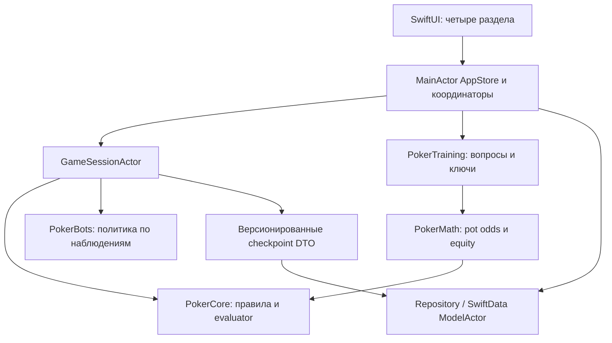

# M14–M18: редакция контента 5

25 октября 2026. Доступны все 60 тем и 18 модулей; 226 уникальных E-ID.
FoundationLesson.finalExercises объединяет CourseTheory (15), CourseReview (15)
и CourseRisk (15). Существующие 181 задания, их редакции и схема JSON6 сохранены.

- M14/M15: равновесие в конечной матрице, чтение отчёта, смешанный EV, паспорт,
  node-lock и проверяемая гипотеза. Источник стратегии — явные условные входы.
- M16: satellite ICM использует прежний CourseICM; все стеки, выплаты и листья
  указаны, сравнение chip EV и ticket EV разделено.
- M17: восстановление решения по доступной информации, классификация ошибок,
  заметки и интервальный ретест как учебные сценарии, итоговый аудит.
- M18: абстрактная случайная прогулка, Байес с заданными likelihood, шумные
  наблюдения, усталость и личные границы. Реальная надёжность требует выборки.

Формулы выполняются типизированной Swift-логикой. CourseBoundariesIntroduction
используется на входе в курс и в M01; ссылка открывает T59 без блокировки по уровню.
Таймеры, личный редактор заметок и календарь повторения описаны только в сценариях.
Игровой движок, боты, evaluator и слой хранения сохранены.

[Матрица](tests/course-coverage.md), [проверки](tests/completion-results.md).
Ниже сохранена история предыдущих редакций.

# Текущее расширение — M10–M13, 22 октября 2026

Контент v4: 181 уникальное задание в опубликованном объёме M01–M13.
CourseAggression/CourseDistributions/CourseICM содержат типизированную математику;
FoundationDecisionTree показывает ветви и единицы. Хранение: локальный JSON schema6.
Существующий cash-practice стол 6-max и пять ботов используют прежний движок.
[Контракты](course-architecture.md), [проверки](tests/advanced-results.md).

Ниже сохранена история архитектурных этапов.

# Текущее расширение курса — M05–M09, 21 октября 2026

Нативный SwiftUI и локальный JSON schema6. Контент v3: 132 уникальных задания;
стабильные идентификаторы и все восемь прежних наборов сохранены.
Новые типизированные провайдеры: CourseEstimation, CoursePreflop, CourseRangesPostflop.
Движок и боты используют прежнюю реализацию. Контракты и ограничения:
[архитектура курса](course-architecture.md), [покрытие](tests/course-coverage.md),
[результаты](tests/intermediate-results.md).

Ниже — описание исходной архитектуры и предыдущих этапов.

## Текущий этап M01–M04

Каталог редакции2 объединяет прежние43 упражнения с новыми FoundationExercise.
Проверка ответов выполняется Swift; единый атомарный JSON schema6 читает версии1–5
и сохраняет все прежние категории. [Контракт](course-architecture.md),
[покрытие](tests/course-coverage.md), [проверки](tests/foundations-results.md).

## Общий урок и адресные задачи —20 октября2026

Каталог связан с прогрессом тем и модулей. Все43 существующие задачи открываются
по E-ID через общий шаблон с сохранённой историей. Текущий контракт:
[course-architecture.md](course-architecture.md),
[design/lesson-template.md](design/lesson-template.md).

## Профили ботов — 20 октября 2026

Актуальный контракт пяти уровней, информационная граница, отмена и условные
математические модели: [bot-profiles.md](bot-profiles.md).
Один MainActor-владелец движка; фоновому вычислителю передаются immutable values.

# Действующая архитектура: офлайн-курс и каталог

20 октября 2026. Нормативное дополнение текущего этапа: [course-architecture.md](course-architecture.md). Оно определяет каталог, связи ID и сохранение прогресса. Последующий текст фиксирует исторический план от 16 октября.

Действующий стек: Swift 6 / SwiftUI, iOS 17+, локальный PokerCore и атомарный Codable JSON через PracticeHistory/PracticeStore. Application и Persistence владеют состоянием на MainActor. CourseCatalog редакции2 содержит 60 тем / 18 модулей / 4 уровня / 82 опубликованных упражнения. Ответы проверяются существующими типизированными Swift-моделями.

`PracticeHistory` читает schema 1–6; чтение создаёт PracticeArchive и производные LearningCourseSnapshot/CourseCatalogSnapshot. Запись нормализует архив в schema 6 с сохранением UUID, Date, ответа, grade и прежнего завершения наборов. Математические правила, evaluator, игровой ledger и боты остаются самостоятельным существующим слоем.

Сквозной маршрут: Тренировка → каталог → M03 → T11 → отдельное pot-odds упражнение → JSON → перезапуск → восстановленный охват. Остальные семь типов/наборов доступны через их прежние экраны; два набора T11 используют общую тему.

Исторические предложения SwiftData, GameSessionActor и разбиения на несколько targets ниже служат контекстом планирования. Реализованная схема компонентов и файла описана в дополнении от 20 октября.

---

# Архитектура собственного офлайн-тренажёра NLHE для iOS

Дата: 16 октября 2026. Статус: проектное решение для реализации, код ещё предстоит написать.
Корень проекта: `/Users/kr1ny77/Desktop/Poker/`.

## 1. Основание и адаптация процесса

Прочитаны `requirements.md` и все исследовательские документы: `research/recon.md`, `research/features.csv`, `research/sources.md`, `research/game-plan.md`. Последний восстановлен в папке Poker копированием ранее созданного документа из рабочей папки; исходная копия сохранена.

Процесс replica-architect адаптирован: стек → локальная модель данных → контракты компонентов → риски → вертикальный прототип → версия 1. Схема хранения описана концептуально в этом документе. SQL, сетевые маршруты, серверные службы и исходный код на данном этапе отсутствуют.

Все архитектурные решения ниже — предложения для собственного продукта. Blackjack Wiz задаёт ориентир короткой практики и понятного ответа интерфейса. Сведения о его функциях и версиях остаются в исследовании со статусами источников. Рекламируемые возможности покерных конкурентов служат материалом сравнения; методы их реализации неизвестны.

### Разрешение противоречий исходных документов

| Вопрос | Решение этого документа |
|---|---|
| Движок игры и «отдельный игровой движок не нужен» в game-plan | Собственный модуль правил PokerCore обязателен; 2D-стол отображается средствами SwiftUI. Дополнительный графический runtime для v1 избыточен. |
| Максимальная ставка ограничена «эффективным стеком» | Максимум команды — собственный оставшийся стек плюс уже внесённое на улице. Эффективный стек применяется к учебному контексту; возврат непокрытого вклада и side pots рассчитывает движок. |
| EV указан и в следующем релизе, и в будущих идеях requirements | Числовой EV стратегии отложен до появления проверенной модели. В v1 — pot odds, equity и ограниченные математические примеры с раскрытыми допущениями. |
| «Полный прототип» одновременно с одной задачей на флопе | P0 — внутренний вертикальный прототип с одной задачей. V1 — первая полноценная версия с полной раздачей и базовыми учебными модулями. Правила all-in и банков входят в движок до включения произвольной игры. |
| Автоматический рейтинг навыка | V1 показывает попытки и точность по опубликованному ключу упражнения. Elo, универсальный skill rating и интерпретация выигрышей как навыка отложены. |

## 2. Точные допущения V1

Все пункты — выбранный проектный профиль `NLHE6Practice-v1`, который должен получить экспертную проверку до выпуска.

| Область | Принято для V1 |
|---|---|
| Платформа | iPhone, iOS 17+, Swift 6 в режиме строгой проверки конкурентности; точную версию Xcode фиксировать при старте разработки |
| UI | SwiftUI, portrait; русский интерфейс, покерные термины с краткими пояснениями; iPad получает совместимую компоновку, отдельная iPad-версия — позже |
| Стол | Всегда шесть занятых мест: пользователь и пять локальных ботов; seat ID стабилен, позиция вычисляется от button |
| Формат | Учебный кэш-подобный NLHE, SB=5, BB=10, старт каждого места=1000 фишек (100 BB); ante=0, rake=0 |
| Фишки | Минимальная единица 1, суммы Int64 с проверкой переполнения; отображение в фишках или BB сохраняет исходное целое значение |
| Между руками | Положительные стеки переходят в следующую руку. Место с нулём получает 1000 учебных фишек перед новой раздачей; пополнение записывается отдельным событием. Пользователь видит бесплатное пополнение и может завершить сессию |
| Button | При новой сессии seat 0 (hero); далее один шаг по часовой стрелке между руками. Все места снова заняты и имеют положительный стек; профиль сокращённого/heads-up стола отложен |
| Колода | 52 карты, одна колода на руку; перед flop/turn/river по одной burn card; один runout; раздача по одной карте два круга от SB |
| Вскрытие | При завершении торгов с двумя и более живыми руками открываются все живые руки. При окончательном all-in/runout живые руки открываются после закрытия всех решений; фолднувшие остаются скрытыми |
| Непокрытый вклад | Возвращается владельцу до окончательного деления банков; вычисляется по реальным вкладам всех участников, включая фолднувших |
| Ничья | Каждый банк делится отдельно; остаток по одной фишке получают связанные победители по часовой стрелке от места слева от button |
| Боты | Пять экземпляров одного учебного профиля «Базовый v1»; профили/реплики интерфейса явно сообщают уровень |
| Тренировка | Курируемые задачи и объяснения в bundle, версии контента и ключей. Первые категории перечислены в разделе 9; количество задач зависит от экспертной приёмки |
| Сохранение | Один локальный SwiftData-store, ручное сохранение важных переходов; аккаунты и облачная синхронизация отсутствуют |
| Коммерческие рамки | Виртуальные фишки, бесплатные пополнения, без рекламы, подписок, IAP и денежных операций |
| Контент | Оригинальные тексты, графика, интерфейс и учебные сценарии; ссылки на референсы остаются внутренними исследовательскими материалами |

Фишки внутри руки подчиняются закону сохранения. Между руками бюджет сессии изменяется только на явно зарегистрированные учебные пополнения. Базовый профиль не требует правил выбывания, dead button, heads-up, турнирных выплат или ICM.

## 3. Стек и компоненты

| Компонент | Ответственность | Допустимые зависимости |
|---|---|---|
| PokerCore | Карты, состояния, команды, очередь ходов, ставки, банки, определение результата | Swift/Foundation; собственный RNG; evaluator внутри Core |
| PokerMath | Pot odds, outs, equity, перечисление взвешенных комбинаций | PokerCore; собственные математические значения |
| PokerBots | Выбор действия базовой политикой | Публичная проекция PokerCore и legal actions |
| PokerTraining | Каталог упражнений, ключи, оценка ответа и объяснение | PokerCore, PokerMath; bundle JSON |
| Application | Сессии, маршрутизация команд, проекции, отмена задач и координация сохранения | Все доменные модули через узкие контракты |
| Persistence | SwiftData-модели, репозитории, миграции, восстановление | Foundation, SwiftData; сериализуемые доменные DTO |
| UI | SwiftUI-экраны, навигация, отображение, ввод, анимации, доступность | Application, публичные DTO; без доступа к private hand state |

Вначале доменные модули — отдельные targets одного локального Swift Package. Application, UI и Persistence — каталоги/targets приложения; отдельные сервисы или сторонние зависимости вводятся только под доказанную потребность.



Core и evaluator проверяются независимо от интерфейса и учебных рекомендаций. Учебный ответ определяет PokerTraining; легальность хода определяет PokerCore. Расчёты PokerMath меняют только результат своего запроса.

## 4. SwiftUI и маршрутизация

Корень — TabView с четырьмя разделами; у каждого свой NavigationStack и типизированный путь. Observation обновляет экран из наблюдаемой модели приложения; типизированные значения пути связываются с destination SwiftUI. Основание: [Apple: управление моделью](https://developer.apple.com/documentation/swiftui/managing-model-data-in-your-app), [Apple: NavigationStack](https://developer.apple.com/documentation/swiftui/understanding-the-navigation-stack).

| Раздел / экран | Вход / маршрут внутри приложения | Владелец состояния | Состояния UI |
|---|---|---|---|
| Играть — PlayHome, S01/S02 | tab.play | PlayCoordinator | новая сессия, продолжить, сохранение недоступно |
| Играть — Table, S04 | play.table(sessionID) | GameSessionActor → TableSnapshot | ход hero, ход бота, runout, результат, пауза, ошибка |
| Играть — HandReview, S09 | play.review(handID) | ReviewStore | шаг действия, улица, финал, запись недоступна |
| Тренировка — Catalog/Setup, S02/S03 | tab.training → setup(topic) | TrainingCoordinator | список, выбранный набор, пустой фильтр |
| Тренировка — Exercise, S05 | training.exercise(runID, itemID) | TrainingSession | вопрос, введённый ответ, проверка, объяснение |
| Тренировка — Summary, S06/S07 | training.summary(runID) | SummarySnapshot | итоги, нет оценённых ответов, частичная сессия |
| Прогресс — Overview, S08 | tab.progress | ProgressStore | пусто, число попыток, разрезы по теме |
| Прогресс — History/Attempt | progress.history → attempt(id) | ProgressRepository | список, контекст и сохранённый разбор |
| Настройки, S10 | tab.settings | SettingsStore | правила, подсказки, motion, очистка, сведения |

В путях содержатся ID и значения фильтров. Полная раздача и закрытые карты хранятся у координатора сессии. Переключение вкладок приостанавливает очередь ботов на следующей границе команды; возвращение продолжает тот же экземпляр сессии. Одна игровая сессия и одна учебная сессия могут находиться в памяти, но обработка активного режима выполняется последовательно.

Повтор упражнения из «Прогресс» передаёт фильтр в TrainingCoordinator и выбирает вкладку «Тренировка». Возврат к результатам сохраняет исходную точку навигации. Пауза, подтверждение сброса и справка используют sheet/alert. Анимация показывает уже принятое доменное событие; её пропуск переключает представление к последнему снимку.

MainActor AppStore и наблюдаемые view models содержат только проекции и состояние ввода. TableLayout, SeatView, CardView, BoardView, PotView и ActionBar получают значения. В ActionBar draft ставки локален до подтверждения; отправленная команда несёт сумму «до» и ожидаемую ревизию.

## 5. Состояние игровой сессии и обработка команд

### Владение состоянием

GameSessionActor — единственный владелец изменяемого состояния игры. Доменный HandState — value type. Сам переход PokerCore синхронный и детерминированный: состояние + команда + зафиксированная случайность → следующее состояние + события или доменная ошибка.

| Значение | Состав |
|---|---|
| TableConfig | rulesVersion, seatCount, SB, BB, chipUnit, maxStartingStack, dealerPolicy |
| SessionState | sessionID, config, button, seats, handID, revision, ledger пополнений, phase |
| HandState (private) | handID, hole cards, board, burn cards, оставшаяся deck order/cursor, улица, actorSeat, вклады, очередь обязательных ответов, raise rights, RNG states |
| SeatState | стабильный seatID, оставшийся stack, contributedStreet, contributedHand, active/folded/allIn, lastAction metadata |
| BettingState | currentBet, lastFullRaiseSize, openingBetComplete, pendingResponders, уровень ставки/права raise для каждого места |
| Settlement | возвраты, слои банков, eligible seats, ranks, доли выплат, odd chips |
| TableSnapshot (public) | видимые карты, публичные вклады/стеки/статусы, legal actions для hero, сумма call, банк, улица, revision |
| BotObservation | карты конкретного бота, публичная история, доска, его legal actions и позиция |

Фазы: idle → dealing → preflop → flop → turn → river → settling → completed. Ранний uncontested win завершает любую улицу; окончательный all-in запускает runout оставшейся доски. Момент animations/presentation не входит в фазу правил.

### Командный цикл

1. Команда содержит commandID, sessionID, handID, expectedRevision, actorSeat и payload. Повтор commandID возвращает ранее принятый результат; старые ревизии отклоняются с актуальным snapshot.
2. Actor проверяет очередь и legal actions, вычисляет новое состояние в памяти и его события.
3. Новое состояние и последняя принятая команда фиксируются одним checkpoint через репозиторий. Во время await сохранения actor держит флаг inFlight и очередь входов; повторный вход проходит через тот же шлюз.
4. После успешного сохранения actor принимает новую ревизию и публикует публичную проекцию. Ошибка записи оставляет предыдущую ревизию канонической; UI предлагает повтор сохранения или завершение без дальнейших ходов.
5. Следующий бот получает observation с ревизией. Его результат принимается только для того же handID/revision/actorSeat. После новой руки, паузы или восстановления старые задачи отменяются.

Уход в фон отменяет вычисления/presentation, сохраняет принятый checkpoint и приостанавливает игру. При возврате выполняется ровно одна следующая команда. Ошибки deck/ledger/правил переводят игру в диагностическую паузу с предложением начать новую руку; сохранённые результаты остаются доступны.

### Контракты вместо HTTP API

| Операция | Вход | Результат | Поток |
|---|---|---|---|
| startSession | TableConfig, стартовый seed | sessionID, TableSnapshot | F02 |
| startNextHand | sessionID, revision | новый checkpoint, snapshot | F02 |
| submitAction | command envelope + действие | snapshot, публичные события либо error | F02 |
| observeAsSeat | seatID, revision | BotObservation | F02, внутренний вызов |
| beginTraining | presetID, версии content | TrainingSnapshot | F01 |
| submitAnswer | attemptID, itemID, answer, revision | AnswerReview + обновлённый прогресс | F01/F03 |
| calculateEquity | immutable request, requestID | exact/estimated result, параметры | F01 |
| fetchProgress | период, тема, hints mode | агрегаты и число наблюдений | F03 |
| loadCheckpoint | sessionID | валидированный checkpoint или recovery error | F02 |
| clearLocalData | подтверждённая команда, dataGeneration | новая чистая база/состояние | настройки |

## 6. Колода и оценка комбинаций

### Колода

CardID в диапазоне 0…51 однозначно отображается в rank 2…A и suit. Fisher–Yates получает независимый источник равномерных целых; модульное смещение при выборе индекса исключается алгоритмом выборки. Для обычной руки начальная случайность берётся из системного источника, затем используется собственный версионированный детерминированный RNG. Deck seed и bot seed разделены: скорость/число решений бота сохраняют порядок колоды.

Checkpoint сохраняет порядок колоды, cursor и состояния RNG, а также engine/RNG version. Один seed без версии алгоритма недостаточен для долговременного воспроизведения. Следующая карта извлекается только DeckDealer. Потерянная/дублирующаяся карта — ошибка инварианта. Фиксированная задача создаётся из полностью проверенного сценария с заданным префиксом и продолжением колоды; недостающие карты дополняются из остатка без повторов.

### Лучшая пятёрка

HandEvaluator в PokerCore принимает 5, 6 или 7 уникальных карт. Базовая проверяемая реализация перебирает все пятёрки: 1, 6 или 21 вариант соответственно. Результат — HandRank(category, упорядоченные tie-break ranks) и bestFive для подсветки. Категории от старшей карты до стрит-флеша; роял-флеш отображается как именованный старший стрит-флеш. A–2–3–4–5 получает старшую карту 5; масть на сравнение силы не влияет.

Несколько равноценных bestFive выбираются стабильным правилом отображения; сравнение победителей зависит только от HandRank. Board-only комбинация и использование 0, 1 или 2 hole cards допустимы. Высокопроизводительные lookup tables вводятся после профилирования equity и сверяются с этим evaluator как с простой контрольной реализацией.

## 7. Проверяемые правила торговли и расчёта банков

Раздел задаёт исполняемый профиль игры и контрольные примеры. Он нуждается в экспертной приёмке; учебные эвристики из разделов 8–9 не меняют эти правила.

В качестве источника для reopening, отдельных side pots и odd chip выбран [Poker TDA: правила 2026, v1.1 от 21 сентября](https://www.pokertda.com/view-poker-tda-rules/). TDA описывает турниры; профиль приложения заимствует перечисленные технические положения и отдельно фиксирует свои кэш-подобные допущения. Источник требует учитывать накопленные short all-in относительно конкретного уже действовавшего игрока; minimum raise сохраняет величину последнего полного повышения. Каждая ничья рассчитывается отдельно для своего банка, остаток получает первый подходящий победитель слева от button. Остальная декомпозиция ниже — собственный проектный контракт реализации.

### Очередь и legal actions

Для шести мест clockwise порядок позиций: UTG, HJ, CO, BTN, SB, BB. Preflop первым действует UTG; после флопа — первое активное место со стеком слева от button. Фолднувшие/all-in пропускаются. Big blind сохраняет возможность check/raise, когда остальные только уравняли.

Раунд закрывается после ответа всех обязаннных действовать игроков, при уравненных требуемых вкладах у всех оставшихся игроков со стеком. Совпадение вкладов само по себе недостаточно: все ещё должны получить возможность хода. Если живым остаётся одно место, банк присуждается сразу. Если со стеком осталось одно место и у него есть недоплаченный call, оно получает fold/call; после разрешения этого решения переход — runout. Ставки в пустой побочный банк при отсутствии способного ответить оппонента исключаются.

Пусть S — оставшийся стек действующего, x — его вклад на улице, B — текущая ставка улицы. Сумма call = min(S, max(0, B−x)). При x=B доступен check; при B>x — fold/call. Для fold при нулевом call v1 предлагает check, исключая случайный отказ от бесплатного просмотра. Bet/raise доступны только при наличии права увеличения ставки и оппонента, способного отвечать. Команды raiseTo(T) используют общий вклад на данной улице: добавляется T−x. Максимум T=x+S.

Минимальная полная открывающая ставка BB=10; обычный полный raise повышает текущую ставку минимум на lastFullRaiseSize. В начале preflop B=10 и lastFullRaiseSize=10. Полный raise обновляет этот размер своей дельтой. Short all-in меняет B и обязанность доплатить, сохраняя размер последнего полного повышения. Право на новый raise вычисляется для каждого игрока по истории его последнего действия; хранение одного общего hasActed недостаточно.

Особый случай — открывающий all-in меньше BB после флопа. BettingState различает неполную opening bet и полную ставку. При первом в раунде all-in 4 следующий игрок с достаточным стеком может raiseTo(14) либо выше: увеличение на полную минимальную ставку 10. Поднятие до 10 трактуется как отдельное спорное правило completion и в принятом NL-профиле исключено. Чекнувший ранее игрок и цепочки таких ставок должны быть проверены на принятом правиле до выпуска.

All-in — UI-сокращение для легального call или увеличения до x+S. Оно допускает сумму меньше полного минимума при исчерпании стека; игрок с закрытым правом raise получает только разрешённый call, даже если его кнопка all-in могла бы поднять ставку. Все amounts проходят валидатор Core до списания фишек.

Контрольные последовательности (вклады на улице):

- B=10, raiseTo(30) даёт полный прирост 20; следующий полный минимум — 50.
- После ставки 100 short all-in до 150 требует доплаты 50; игрок, действовавший на 100, сохраняет закрытое право raise при одном таком повышении.
- Следующий short all-in до 200 суммарно открывает raise тому, кто действовал на 100. Игрок, успевший уравнять 150, при возврате к 200 имеет собственный контекст и право проверяется отдельно. Последнее полное повышение 100 даёт очередной полный минимум 300.

### Банк, возвраты и слои

В течение руки authoritative ledger содержит stack, contributedStreet и contributedHand каждого места. UI potTotal = сумма contributedHand, включая текущую улицу; фишки возле мест — дополнительная визуализация этих же вкладов. Ledger списывает каждую фишку ровно один раз.

После закрытия торговли вернуть единоличный непокрытый верхний вклад: разницу между максимальным и вторым максимальным суммарными вкладами, если максимум уникален. Фолднувшие вклады участвуют в определении уже покрытых сумм. Возврат уменьшает contributedHand/соответствующий вклад улицы и увеличивает stack; затем строятся слои по различным положительным уровням вкладов.

Для уровней c1<c2<… и c0=0 размер слоя j равен (cj−c[j−1]) × числу мест с вкладом не меньше cj. Eligible — внесшие достаточно игроки с живой рукой. Вклад фолднувшего включён в сумму, право на выигрыш отсутствует. Каждый слой рассчитывается по ranks своих eligible; возможен один победитель без сравнения. Пустой eligible set означает ошибку допустимости состояния и диагностическую остановку. При одной живой руке после возврата ей присуждается весь оставшийся банк.

Пример: вклады A=100, B=250, C=400. Возврат C=150. Main pot=300 для A/B/C, side pot=300 для B/C; выплата определяется отдельно. Если C сфолдил в другом допустимом примере, его покрытые вклады остаются в банках, но C исключается из eligible.

При ничьей каждый победитель получает floor(pot/winnerCount); оставшиеся единицы раздаются по принятому clockwise порядку. Перед новой рукой ledger удовлетворяет: сумма стеков + нераспределённые вклады = бюджет до руки. Settlement содержит отдельные возвраты и выплаты с ID; повторное применение запрещается ревизией/идемпотентностью команды.

## 8. Локальные боты: уровень и границы

`Basic-v1` — начинающий учебный соперник с фиксированными авторскими таблицами префлопа и простыми постфлоп-правилами. Все пять экземпляров имеют одну политику; имена/аватары различают места. Случайность действий задаётся независимыми per-seat потоками. Профиль сохраняет version и параметры; это позволяет воспроизвести раздачу после обновления приложения.

Вход политики: BotObservation, legal actions, profile, RNG state. Выход: одно действие и выбранный новый RNG state. Observation содержит только две собственные карты бота, общую доску, размеры/публичные действия, позиции и стеки. Полная колода, burn cards, карты других игроков и будущие события недоступны через контракт.

Политика v1: выбирать preflop из небольших проверенных авторами таблиц по позиции/предыдущему действию; postflop учитывать текущую категорию руки и заданные draw-признаки; использовать check при бесплатном ходе слабой руки, ограниченную частоту call и несколько value-сайзингов при более сильной. Точные пороги и таблицы — отдельные версионированные данные, принимаемые экспертом. Вероятность победы и оптимальная стратегия такими признаками не подменяются.

Для P0 разрешён scripted профиль, покрывающий все ветви одного упражнения с легальным fallback. В V1 вне таблиц используется явный безопасный fallback: check при бесплатном ходе, иначе fold. При технической ошибке политики применяется тот же fallback, сохраняется локальный диагностический код. Низкая сложность, отсутствие глубокой модели диапазонов и ограниченное блефование объясняются в справке. Ответ бота никогда не служит ключом правильности ответа пользователя.

## 9. Упражнения и проверка ответов

### Контент и учебная сессия

Bundle содержит оригинальные JSON-наборы: Scenario, RangeDefinition, BotProfile и тексты объяснений. Manifest хранит contentVersion, rulesVersion и перечень ID. Scenario включает тему, условия стола, видимые карты, public action history, тип вопроса, варианты/единицы ввода, ключ ответа, explanation, источники/допущения, reviewStatus и версию методики.

Полный private fixture раздачи доступен GameSessionActor при задаче с продолжением. UI получает только ScenarioPrompt. До принятия ответа UI не получает ключ или будущие карты. Учебный режим с заданной рукой оппонента явно сообщает, что эти карты известны по условию; такие задачи отделены от обычной игры.

TrainingSession хранит упорядоченный список ID+versions, индекс вопроса, состояние answering/submitting/review/finished, подсказку и attemptID. После первого принятого ответа попытка фиксируется один раз; повторный тап возвращает тот же review. «Попробовать снова» создаёт новую попытку, отмеченную как повтор с показанным ранее объяснением.

### Модули и типы ключа

| Тема | Проверяемый результат | Формат ответа / граница эвристики |
|---|---|---|
| Комбинации | HandRank и лучшая пятёрка | Категория, победитель либо ничья; алгоритмическая проверка |
| Позиции | Вычисленная позиция от button | Выбор места/позиции; правила 6-max |
| Стартовые руки | Принадлежность авторскому диапазону указанного формата | CuratedAnswerKey; источник и версия диапазона видимы |
| Outs | Уникальные карты, удовлетворяющие заданному predicate | Целое число; различать улучшение категории и выигрыш против известной руки |
| Шансы банка | call cost / итоговый eligible pot | Процент, допустимая погрешность ввода ±0,5 процентного пункта |
| Equity | Доля выигрываемого банка на данном распределении | Числовой интервал с заранее зафиксированным допуском; точный эталон для оцениваемых задач |
| Размеры ставок | Legal action и/или ответ по ограниченному учебному ключу | «До X фишек», легальность от Core; стратегический выбор явно маркирован |
| Диапазоны | 169 классов → конкретные комбинации с весами | Просмотр/принадлежность; частоты относятся к данному учебному набору |
| EV | Сначала только одноходовые all-in/call примеры | Раскрытая математическая модель; расширенная EV-стратегия — будущий этап |

ReviewResult различает correct, incorrect, acceptableAlternative, ungraded. Score сохраняется только при наличии принятого ключа. Несколько допустимых действий задаются самим ключом; частоту смешанной стратегии нельзя проверить по одному ответу. В V1 «правильно» означает согласие с опубликованным ключом данной задачи.

P0: одна задача на флопе с заранее проверенным контекстом и объяснением, повторение и переключатель подсказки. Ветви ответов обрабатываются движком; продолжение руки — отдельный результат. V1: ограниченные наборы по всем перечисленным темам, поддерживаемые виды ответов и справочные формулы. Пустой фильтр возвращает сообщение и сброс, а непрошедшая валидацию задача исключается с локальной диагностикой.

## 10. PokerMath: pot odds, equity и ограничения

### Pot odds

Для простого heads-up call: P — банк непосредственно до ставки соперника, B — его ставка, C — цена колла. При отсутствии дальнейших ставок/рейка итоговый банк P+B+C, порог equity = C/(P+B+C). Альтернативный вход сервиса — доступный текущий банк Q, уже включающий ставку оппонента; тогда порог C/(Q+C). Тип запроса фиксирует соглашение о Q. Пример P=100, B=C=50 → 25%.

При C=0 возвращается «бесплатный check», а процент как требование к оплате не показывается. При отрицательных/переполненных суммах или пустом eligible pot — input error. Произвольные multiway side-pot call не сводятся к одному общему pot odds: v1 оценивает такие задачи только при явно заданных доступных слоях и закрытии торговли; иначе выводится справка о границе расчёта. В ходе полной игры автоматический совет о выгодности такого колла отсутствует.

### Equity

EquityRequest содержит hero cards, board, явную руку или взвешенный диапазон одного соперника, известные dead cards, метод exact/MonteCarlo, algorithmVersion и requestID. V1 ограничивает интерактивный калькулятор heads-up all-in/showdown equity. Полный шестиместный движок играет все руки; расчёт multiway-equity — отдельное расширение.

Чужие сфолдившие закрытые карты и burn cards остаются неизвестными калькулятору; алгоритм использует только объявленные dead cards. Равномерное распределение неизвестного остатка интегрирует и неизвестные burn cards. Board enumeration исключает выбранные hole cards обеих сторон и объявленные dead cards.

- Exact: перебор совместимых рук диапазона и возможных runout с весами. Для двух известных рук на флопе остаётся C(45,2)=990 досок; результат воспроизводим.
- Monte Carlo: независимые корректно взвешенные выборки без повторения карт в одной симуляции; seed и sampleCount сохраняются. Начальный лимит 20 000 выборок, UI допускает отмену/повтор с большим лимитом после профилирования.
- Для каждой симуляции X=1 при победе, 1/k при делении между k победителями и 0 при проигрыше. Equity — среднее X; win/tie отображаются отдельно. Для оценки погрешности считать дисперсию именно X; показывать приближённый 95% интервал и число выборок, ограничив интервал [0,1]. Интервал описывает только ошибку выборки.
- Диапазон задаётся весом каждой конкретной двухкарточной комбинации. Pair/suited/offsuit классы дают 6/4/12 комбинаций до card removal. Заблокированные комбинации исключаются, оставшиеся веса нормируются; пустое множество — явная ошибка.

Оцениваемые numeric drills используют exact эталон или заранее вычисленный и независимо проверенный ключ. Monte Carlo служит исследованию и демонстрации; флуктуации не меняют правильность ответа упражнения.

### Выполнение и EV

Equity выполняется в отдельном worker actor с кооперативной отменой между пачками. Результат содержит requestID/contentVersion и применяется только к актуальному экрану/вводу. Immutable кеш keyed по всем картам/весам/версии/методу имеет ограничение памяти; освобождается при memory warning. Сессионный RNG колоды для расчёта equity не используется.

Ограниченный пример all-in call на последней улице без дальнейших решений: EV(call) относительно fold = equity × (Q+C) − C, где Q — уже доступный банк до колла. В v1 такое выражение показывается только с заданным распределением рук и раскрытым условием полного завершения ставок. Полное EV дерева с фолд-эквити, сайзингами, диапазонами и будущими улицами требует отдельной модели/проверки и отложено.

## 11. Локальное хранение и восстановление

Выбор — один SwiftData ModelContainer локально в Application Support с отключённой cloud-конфигурацией. PersistenceModelActor сериализует операции; наружу возвращает value DTO, а SwiftData-модели остаются внутри persistence-контекста. SwiftData отвечает за межзапускное хранение ([Apple: сохранение модели](https://developer.apple.com/documentation/swiftdata/preserving-your-apps-model-data-across-launches)); изоляция репозитория опирается на [ModelActor](https://developer.apple.com/documentation/swiftdata/modelactor).

### Пять типов persistent records

| Запись | Основные поля | Связи / удаление / выборка |
|---|---|---|
| SettingsRecord | singletonID, schemaVersion, hints, motion, displayUnits, rulesPreset, locale, updatedAt | одна запись локальной установки; чтение по singletonID |
| GameSessionRecord | UUID, createdAt, updatedAt, status, rulesVersion, configData, currentCheckpointData, revision, initialBudget, topUpLedger | session → HandRecord cascade; по updatedAt/status |
| HandRecord | UUID, sessionID, ordinal, status, rulesVersion, start/end stacks, eventLogData, publicReviewData, settlementData, checkpointVersion | принадлежит сессии; ключ sessionID+ordinal; хронология |
| TrainingSessionRecord | UUID, createdAt, endedAt, presetID, contentVersion, orderedItemsData, index, status, currentAttemptID | session → AttemptRecord cascade; по createdAt/status |
| AttemptRecord | UUID, trainingSessionID, itemID, itemVersion, topic, promptSnapshot, answer, gradingVersion, reviewSnapshot, grade, hintsUsed, repeated, answeredAt | уникальный attemptID; поиск по времени/теме/результату |

UUID обеспечивают идентичность без аккаунта. Даты — UTC-инстанты; отображение локализовано. Серии по дням в будущем потребуют отдельной календарной политики. Связи обязательны; удаления выполняются репозиторием. Для status/grade используются ограниченные доменные значения, проверяемые при encode/decode. Логические ограничения уникальности и индексы выбора фиксируются в schema design реализации с учётом API минимальной iOS. Преждевременная зависимость от новых API индексов исключается ограничением iOS 17.

RangeDefinition, Scenario и BotProfile в bundle — read-only контент; в базе лежат их версии и snapshots использованного объяснения. История сохраняет первоначальную оценку после изменения набора. Изменённая методика не переписывает старый grade автоматически. Агрегаты прогресса вычисляются из AttemptRecord; дополнительного authoritative рейтинга нет.

### Атомарность

- Gameplay commit сохраняет checkpoint, revision, command receipt и HandRecord в одной операции save одного контекста. При ошибке выполняется rollback контекста и очистка staged результата.
- Учебный commit сохраняет AttemptRecord и новый индекс TrainingSessionRecord одним save; UUID попытки защищает от повторной записи.
- Autosave не определяет моменты игрового commit: важные операции сохраняются явно до публикации принятого результата.
- Чтение immutable snapshots и запись координируются одной очередью. Операция сброса сначала отменяет работу actors и повышает dataGeneration; поздние результаты старого поколения отвергаются.

### Checkpoint, review и миграции

Checkpoint — versioned Codable payload в записи активной сессии. Он содержит необходимые private deck/cards, события, RNG, per-player raise state и engine version. PublicReviewData отдельно содержит только виденные/раскрытые карты. Review UI получает исключительно publicReviewData; seed/private checkpoint через UI-модели не передаются.

На восстановлении проверить schema/engine/RNG versions, уникальность карт, cursor, ledger, очередь ходов и допустимость фазы; затем построить actor. Миграции добавляют поля с явными defaults и контрольными примерами. Несовместимая активная рука завершается как unavailable с объяснением, при этом история попыток сохраняется; уничтожение всей базы при ошибке запрещено. Повреждённое хранилище даёт экран восстановления/явного локального сброса.

Файлы наследуют iOS Data Protection; точный режим доступа сверяется на устройстве с фоновой паузой. Облачная синхронизация отсутствует; политика системного резервного копирования перечислена среди открытых вопросов. Все исходящие сетевые вызовы, аккаунты, рекламные SDK и платёжные библиотеки исключены из реализации по продуктовому контракту.

## 12. Структура проекта

Предлагаемая структура — план каталогов, исходники ещё не созданы:

```text
Poker/
  replica/
    requirements.md
    architecture.md
    research/{recon.md,features.csv,sources.md,game-plan.md}
  screenshots/reference/             # исследовательские материалы
  PokerTrainer.xcodeproj/            # рабочее имя, окончательное позже
  App/
    Bootstrap/                       # composition root и зависимости
    Application/
      AppStore/
      GameSession/
      TrainingSession/
      Progress/
      Routing/
    UI/
      Play/
      Training/
      Progress/
      Settings/
      Components/
      Theme/                         # оригинальная визуальная система
    Persistence/
      Models/
      Repositories/
      Migrations/
      CheckpointCodec/
    Resources/
      Assets.xcassets/
      Training/{manifest,scenarios,ranges,bot-profiles}/
      Localizable.xcstrings
  Packages/PokerDomain/
    Sources/
      PokerCore/{Cards,Random,Evaluator,Rules,Betting,Pots,Projection}/
      PokerMath/{PotOdds,Outs,Equity,Ranges}/
      PokerBots/
      PokerTraining/
    Tests/
      PokerCoreTests/
      PokerMathTests/
      PokerBotsTests/
      PokerTrainingTests/
  AppTests/{Persistence,Session,Navigation}/
  AppUITests/
```

Название PokerTrainer в структуре — технический placeholder. Окончательный бренд выбирается отдельно. Референсные изображения остаются исследовательскими файлами вне app bundle.

## 13. Порядок реализации и доказательства готовности

Ниже план проверок будущей реализации. В рамках этой задачи приложение, исходники и тесты не создаются.

| Этап | Экраны и требования | Компоненты / данные | Условие завершения |
|---|---|---|---|
| M0 — профиль | S10; P-SET-01 | RulesVersion, config, fixtures | Эксперт принимает правила reopening/odd chip и сценарии; известны все ограничения |
| M1 — доменное ядро | Основа S04; P-PLAY-01/02/04 | Card, DeckDealer, evaluator, legal actions, ledger, pots | Контрольные раздачи, инварианты и replay дают одинаковое состояние; side pots/short all-in проверены |
| M2 — P0 вертикаль | S05→S06→S07→S08, минимальные S04/S10; P-TRN-01/10, P-PROG-01/02 | ScriptedBots, одна flop-задача, AppStore, Attempt/TrainingSession records | Офлайн: запуск → ответ → объяснение → сохранённый прогресс → повтор; все варианты ответа принимаются корректно |
| M3 — полноценная игра | S01/S02/S04; P-PLAY-01…04 | Basic-v1 bots, полный hand loop, GameSession/Hand records | Новая рука проходит preflop–river либо раннее завершение, любые legal действия завершаются корректным settlement |
| M4 — восстановление/история | S09/S10; P-PLAY-05, P-PROG-01, P-SET-03 | Repository, миграции, checkpoint/review projections | Kill/relaunch между ходами сохраняет принятую ревизию; replay скрывает закрытые карты; двойных выплат нет |
| M5 — учебная математика | S03/S05/S06; P-TRN-02…08 | Ranking, positions, outs, pot odds, HU equity, ranges | Эталоны проверены; сценарии валидны; UI показывает допущения/погрешность и отменяет устаревшие запросы |
| M6 — V1 приёмка | Все четыре раздела; P-PROG-02/03, P-SET-02 | Filtered drills, аналитика, доступность | Работа в авиарежиме, VoiceOver/Dynamic Type/Reduce Motion, сохранение и очистка, оригинальный контент |
| После V1 | Расширенные P-TRN-09 и адаптация | EV model, multiway equity, repetition | Отдельный scope и независимая математическая проверка |

### Набор проверок ядра

- Evaluator: wheel, board-only, разные кикеры, двойные пары, flush/straight flush, равная сила при разных мастях. Для пяти карт — распределение всех категорий на 2 598 960 комбинациях; для 6/7 — независимые контрольные векторы и сравнение с эталоном.
- Betting: BB option, check-around, полный raise, short call, short opening all-in, несколько неполных raises, reopening по каждому месту и запрет ставки при отсутствии оппонента со стеком.
- Pots: пример 100/250/400, folded contributions, несколько побочных банков, равные комбинации и odd chip в каждом слое; chip conservation после каждой команды и settlement.
- Deck: все карты уникальны, раздача/burn/runout соблюдают профиль; seeded hand replay воспроизводим при отмене бот-задачи и повторе UI-команды.
- Equity: exact на известном river, 990 runout на HU flop, ничья на board-only, blockers/empty range; Monte Carlo сравнивается с exact на наборе фиксированных seeds, а не проходит по одному случайному результату.
- Training/storage: одинаковый attemptID сохраняется один раз; ответы с подсказкой и повторы отделены; миграция/очистка и сбой save не дают двойного начисления/оценки.

Целевые бюджеты для прототипного измерения на самом слабом поддерживаемом iPhone: реакция кнопки ≤100 мс, готовое локальное объяснение ≤150 мс без дисковой ошибки; активная анимация стремится к 60 fps. Тяжёлое equity выполняется асинхронно, UI остаётся доступным, отмена проверяется между ограниченными пачками. Это плановые критерии, фактическая производительность ещё не измерялась.

## 14. Риски и открытые вопросы

| Риск | Как ограничить | Что подтвердить |
|---|---|---|
| Ошибки short all-in/reopening | Письменный профиль и per-player raise rights, табличные fixtures | Экспертный разбор неполной opening bet и накопления raises до M1 |
| Потеря/создание фишек | Один ledger, явные возвраты, atomically saved settlement | Проверки всех банков, odd chip и межруковых пополнений |
| Подмена стратегии эвристикой | Отдельные BotPolicy, CuratedAnswerKey и PokerMath | Ключи/пороги приняты автором учебного контента и экспертом |
| Утечка скрытой информации внутри UI/ботов | DTO-проекции, private checkpoints, отдельный public review | Проверка логов, VoiceOver, истории, equity request |
| Медленный exact equity | HU scope, ограниченные запросы, worker, отмена и кеш | Профилирование на целевом iPhone; критерий переключения exact/MC |
| Потеря состояния при фоне/миграции | Явные commits, версии payload, одна очередь и revision | Fault injection сохранения и восстановление каждой фазы |
| Перегруженный портретный стол | Компактные места, стабильная ActionBar, раскрываемая справка | Интерактивный макет на маленьком iPhone и крупном тексте |

Открытые продуктовые решения с предложенными defaults:

1. **Минимальная iOS:** принять 17 для Observation/SwiftData; потребность в более старых устройствах требует пересмотра хранения/модели наблюдения до разработки.
2. **Вскрытие:** default v1 — открывать все живые руки при showdown; ручной muck и точный живой порядок показа отложены. Согласовать понятность такого учебного упрощения.
3. **База сценариев:** объём и авторство пока открыты; выпускать только проверенные оригинальные задания с фиксированными версиями. Принять список эталонных источников/эксперта до M5.
4. **Боты:** выбрать конкретные таблицы/частоты Basic-v1; scripted P0 уже имеет ясную границу применимости. Пять разных уровней отдельной работы не требуют до готовности базовой политики.
5. **Настройки стола:** v1 фиксирует 5/10 и 100 BB на старте; расширение глубин допускается только вместе с подходящими диапазонами/задачами.
6. **Системный backup:** предлагается разрешить обычное резервное копирование прогресса ОС; отдельную пользовательскую синхронизацию исключить. Правила backup private checkpoint и privacy wording уточнить перед релизом.
7. **Объём истории:** в v1 хранить последние 1 000 public hand reviews и все учебные попытки; чистка старых reviews идёт после завершённой руки, активный checkpoint сохраняется. Порог пересмотреть по измерению размера базы.
8. **Бренд/визуальный язык:** оригинальная система выбирается на следующем шаге проектирования; точное копирование палитры и композиции из старого game-plan уступает требованию собственной айдентики.

## 15. Рекомендуемый следующий шаг

Зафиксировать `NLHE6Practice-v1` и контрольные раздачи, затем подготовить оригинальную систему экранов и интерактивный портретный макет стола через replica-design. Реализацию начать с M1 и вертикали M2, сохраняя границы правил, математики и учебных ключей.
