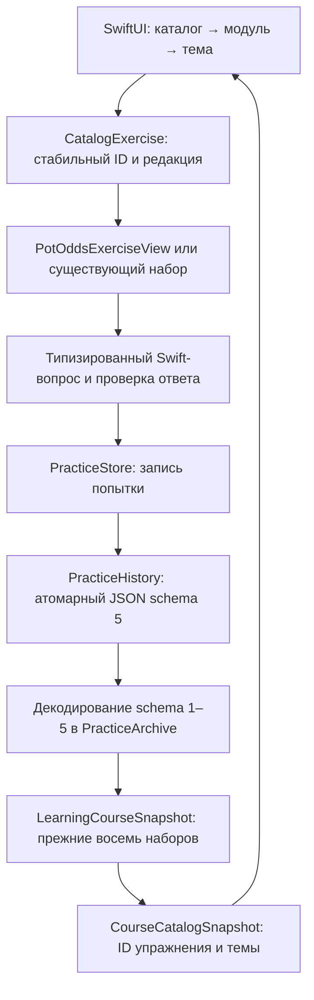

# Каталог курса и совместимость прогресса

Дата: 20 октября 2026. Реализованный этап: каталог редакции 1, общий шаблон урока и адресная маршрутизация43 задач восьми прежних типов.

## Контракты и границы

SwiftUI отображает локальный `CourseCatalog`. Значения каталога и проекции прогресса находятся в PokerCore и используют Foundation. `PracticeStore` на MainActor владеет чтением и записью одного атомарного JSON. Правила NLHE, evaluator и политика ботов сохраняют прежний контракт. Турнирные темы представлены только метаданными будущих учебных сценариев; игровой стол остаётся 6-max против пяти локальных ботов.

Каталог содержит 60 тем, 18 модулей и четыре уровня. 43 существующих упражнения доступны через восемь прежних наборов. Статус темы описывает доступный фрагмент материала; наличие карточки в каталоге обозначает включение в программу. Полный текст и упражнения остальных тем готовятся следующими этапами.

## Идентичность и версия

| Сущность | Контракт | Пример |
|---|---|---|
| Тема | `CourseTopicID` — закрытый тип со стабильным rawValue; название, порядок и модуль меняются отдельно | `T11` |
| Модуль | `CourseModuleID`; названия и уровни — метаданные | `M03` |
| Упражнение | `CatalogExerciseID`; явный опубликованный ID, независимый от индекса массива, seed и отображаемого текста | `E.pot.100.50` |
| Редакция каталога | `CourseCatalog.contentVersion = 1`; определяет опубликованный набор и связи | `1` |
| Редакция упражнения | `CatalogExercise.contentVersion = 1`; задаёт условие и семантику оценки | `1` |
| Попытка | Существующий UUID и Date в одной из пяти типизированных коллекций | Исходные значения сохраняются |
| Исторический ключ | Явный alias `(CourseLessonID, legacyKey)`; ключи исходных уроков заморожены | `potOdds`, `pot-100-bet-50-v1` |

`legacyExercisesV1` хранит исторические определения отдельно от публичного массива текущих упражнений. `CourseCatalog.exercise(lesson:legacyKey:)` разрешает прежний ключ через этот неизменяемый manifest. Отображаемый ID упражнения сохраняется при редакционных исправлениях. Изменение математического условия, допустимого ответа или правила оценки требует новой редакции задания и отдельного исторического alias. При будущей смене редакции потребуется отдельный manifest и тесты исторической проекции; замена v1-ключа новым условием нарушит контракт.

Schema 5 уже хранит редакцию прежних задач в их questionID. Поэтому этот этап использует существующий формат файла. `CourseCatalogSnapshot` добавляет ID и редакцию в памяти, сохраняя исходный payload попытки в `PracticeArchive`. Поля UUID/Date/ответ/результат остаются первичными. Проекция никогда не записывается поверх исходной попытки.

Для будущих новых видов ответа формат файла расширяется отдельной миграцией: новый типизированный payload, `exerciseID`, `exerciseContentVersion`, UUID, Date и зафиксированная оценка. Конкретный новый checker включается Swift-кодом и независимыми тестами. Это следующий самостоятельный этап при добавлении нового вида упражнения.

## Связь восьми наборов с T-ID

| Прежний набор | Заданий | Темы и ограничения |
|---|---:|---|
| `combinations` | 12 | T01: категории, лучшие пять, kicker, wheel, ничья |
| `outs` | 2 | T07: только сбор флеша на следующей карте / к риверу |
| `potOdds` | 3 | T11: точная арифметика цены колла |
| `knownEquity` | 2 | T08: известные руки и точный перебор W/T/L |
| `positions` | 12 | T02: 6 распознаваний + preflop/postflop/relative (9); T21: suited/kicker/prior-actions (3). `relative` дополнительно T39, `prior-actions` дополнительно T22; обе связи понятийные |
| `rangeEquity` | 3 | T09: точный перебор в условных малых диапазонах |
| `evCall` | 3 | T11: +30/−10/0 в заданной риверной модели |
| `blockers` | 6 | T18: все 6; T06: три задачи AA/AKs/AKo |

Каждая попытка превращается в одно `CatalogObservation`. Связь с несколькими темами вычисляется при чтении; она сохраняет один UUID. Прогресс T11 включает шесть упражнений, T02 — девять, T21 — три, T06 — три, T18 — шесть. T22 и T39 имеют по одному понятийному пересечению.

Для сравнения рук полный questionID включает seed/вариант; существующий `comparisonKey` сводит его к одному из 12 исторических шаблонов. Вариация мастей и перестановка участников сохраняют тот же ID упражнения. Сами карты и ответ остаются в исходном payload.

## Типизированная оценка ответа

Публикуемый каталог определяется `Sources/PokerCore/CourseCatalog.swift`. Исследовательский CSV служит планом; приложение читает скомпилированные значения Swift. Метаданные описывают название, связи и метод. Исторический ключ выбирает конкретный вопрос из типизированного провайдера.

| Вид | Swift-модель ответа/проверки | Сохранённый payload |
|---|---|---|
| Pot odds / outs / equity | `PotOddsQuestion`, `FlushDrawQuestion`, `KnownHandEquityQuestion`, `RangeEquityQuestion` | `PracticeAttempt`: число, ожидаемый процент, grade |
| Сравнение рук | `HandComparisonQuestion`, `HandComparisonAnswer`, evaluator | `HandComparisonAttempt`: вопрос, typed answer, grade |
| Позиции | `PositionQuestion` и допустимый индекс | `PositionAttempt` |
| Риверный EV | `EVCallQuestion`, `EVDecision`, точные взвешенные исходы | `EVCallAttempt` |
| Блокеры | `BlockerQuestion`, перечисление физических комбинаций и веса | `BlockerAttempt` |

Каталог передаёт вопрос в прежний экран и сохраняет его прежним путём. Изменение формулы требует изменения Swift-вычислителя и независимых числовых тестов. Строки объяснений отображаются как текст. Границы допустимого ввода и допуск оценки сохраняют прежнюю реализацию.

## Завершение и точность

Прежние восемь наборов продолжают определять завершение через свои 43 `requiredKeys`. Все ответы, включая ошибочные, дают охват; точность считается отдельно. Каталог показывает `completedAvailableExercises` только для опубликованного непустого набора темы. Пустая тема имеет нулевой охват и статус подготовки материала.

Расширение каталога требует отдельного контракта завершения новой редакции. Старое завершение набора и исторические попытки сохраняются. Новая редакция упражнения требует раздельного учёта попыток по паре ID/редакция; перенос оценки между разными математическими условиями требует явного правила и теста.

`LearningCourseSnapshot` выполняет прежнюю проверку допустимости записей и оценки. Неизвестные, но допустимые числовые записи сохраняются в архиве; каталог учитывает только распознанные задания. `ignoredRecords` сообщает число записей вне проекции.

## Чтение и миграция schema 1–5

| Версия на диске | Обязательные коллекции | Результат чтения |
|---:|---|---|
| 1 | `attempts` | Числовые записи + пустые остальные коллекции |
| 2 | `attempts`, `comparisons` | Добавлены типизированные сравнения |
| 3 | Предыдущие + `positions` | Добавлены позиционные ответы |
| 4 | Предыдущие + `evCalls` | Добавлены решения Call/Fold |
| 5 | Предыдущие + `blockers` | Все пять коллекций |

Чтение сначала проверяет структуру версии, UUID, значения и сохранённые оценки; затем создаёт `PracticeArchive`. Отсутствующие в данной версии коллекции становятся пустыми. `LearningCourseSnapshot` и `CourseCatalogSnapshot` строятся из этого значения. Все поддерживаемые версии получают один и тот же контракт каталога v1.

Чтение оставляет байты файла прежними. Первая успешная запись сохраняет весь архив как schema 5 через `Data.write(options: .atomic)`. UUID, Date, типизированный ответ и grade исходных записей переносятся точно. Тесты проверяют это для каждой версии, включая ошибочные ответы, coverage и завершение доступных наборов.

## Ошибки и повтор записи

| Событие | Поведение |
|---|---|
| Файл отсутствует | Пустой архив и доступный каталог |
| Повреждённый JSON, неподдерживаемая версия или неверная структура | Ошибка чтения; байты файла сохранены; `PracticeStore` блокирует обычную запись до успешного reload или явного сброса |
| Ошибка reload после успешного чтения | Последний загруженный прогресс остаётся в памяти, ошибка видна; запись блокируется |
| Отказ атомарной записи | Оценённая попытка остаётся в `pendingAttempt`; опубликованный state Store обновляется после успешной записи |
| Повтор сохранения | Используется прежний UUID/Date pending-попытки; успешный повтор даёт одну запись |
| Повтор уже сохранённого UUID | Store возвращает прежний результат без добавления второй записи |
| Один UUID в разных категориях | Отклонение записи |
| Очистка | Явное подтверждение пользователя; успешная запись пустого архива, затем очистка памяти |

Слой UI выполняет синхронный вызов `PracticeStore.record` на MainActor. Небольшой существующий журнал сохраняется последовательно. В этом этапе добавление фонового actor и смена конкурентной модели не требуются. Для роста истории понадобится измерение стоимости чтения/записи и отдельный проверяемый этап оптимизации.

## Локальные маршруты вертикального среза

| Экран | Переход | Контракт |
|---|---|---|
| S11 Каталог | Тренировка → «Каталог: 60 тем» | 4 уровня и 18 модулей |
| S12 Модуль | Выбрать M03 | Метаданные T08/T09/T11 |
| S13 Тема | Выбрать T11 | Охват шести упражнений, методы и ограничения |
| S05/S06 Упражнение | Выбрать `E.pot.100.50` | Существующий `PotOddsExerciseView`, точный `PotOddsQuestion`, прежняя запись `PracticeAttempt` |
| S13 Тема после relaunch | Повторно открыть T11 | Тот же UUID/Date/результат, охват 1/6 |
| S14 Общий урок | Выбрать любой опубликованный E-ID | Цель, термин, метод, статус расчёта, ситуация/задача, сохранённый результат и следующий E-ID |

Все43 записи каталога открывают конкретную задачу. Семь экранов принимают optional exerciseKey; nil сохраняет полный прежний набор. Проверка, разбор и запись принадлежат существующему экрану. Шаблон читает общий результат по E-ID; отдельной копии попытки нет. Строковые объяснения отображаются как текст.

## Порядок следующих изменений

1. Принять этот каталог и миграционную матрицу целевыми storage-тестами и UI-slice.
2. Добавлять отдельные экраны упражнений для остальных существующих типов с теми же ID и UUID-контрактом.
3. Дополнять текущие темы новыми сценариями, сохраняя исторические aliases и правила завершения редакций.
4. Добавлять новые typed-checkers с отдельными видами payload и явной миграцией при расширении формата.

Первый срез каталога завершался сохранением и восстановлением T11. Общий шаблон расширяет адресный маршрут на все43 опубликованные задачи и прогресс модулей/тем. Полная учебная реализация60 тем выполняется дальнейшими самостоятельными этапами.

## Общий шаблон и прогресс тем — дополнение

`LessonGuide` задаёт оригинальную цель, определение/пример, условия применения,
шаги метода и допущения один раз на семейство задач. `LessonResultKind` отделяет
точный результат, MC-оценку, условную модель, проверенную таблицу и определения.
Существующие задачи используют только подтверждённые своими вычислителями статусы.

`LessonTemplateView` — один маршрут S14. Конкретный экран S05/S06 по-прежнему
владеет ответом, оценкой, pending UUID и save retry. `CourseCatalogSnapshot`
вычисляет overallProgress и progress(in:) через объединение exerciseIDs.
Связанные темы читают одну попытку; UUID/дата/результат и схемы1–5 сохранены.

Наглядные схемы и доступность: design/lesson-template.md.
Приёмка и ограничения: tests/lesson-template-results.md.
