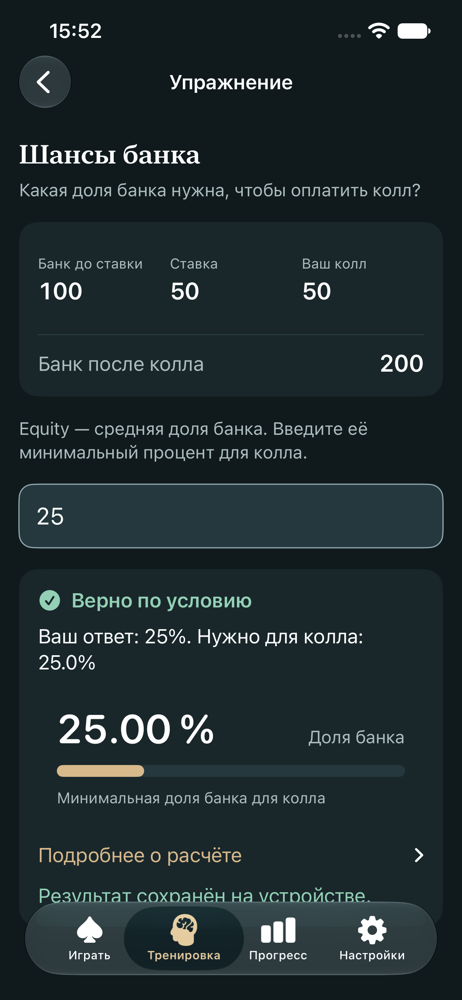
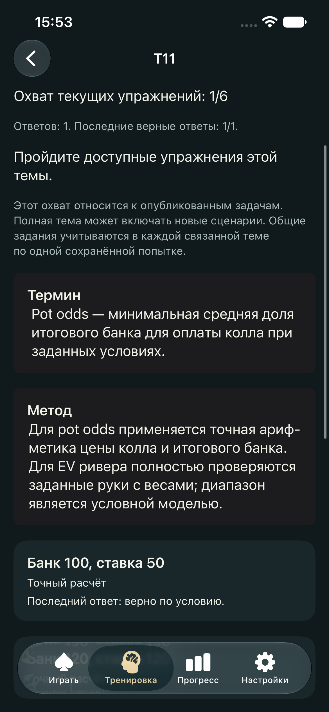

# Результат этапа каталога курса

20 октября 2026. Swift 6.4; iPhone 17e / iOS 27.0 Simulator. Этап: стабильный каталог и сохранение результатов через прежнее хранилище.

| Проверка | Результат | Доказательство |
|---|---|---|
| `./Tools/verify.sh` на финальных исходниках | PASS: 24/24 Core-группы, 10 937 assertions, 46 Swift Testing-тестов, iOS Simulator build, Application/storage | [verify.txt](evidence/course-20261020-155103/verify.txt) |
| Целевой `swift test -c release --filter catalog` | PASS: 6 функций, параметризованный проход всех пяти schema 1–5 | [targeted-tests.txt](evidence/course-20261020-155103/targeted-tests.txt) |
| CAT-UI: каталог → M03 → T11 → отдельное pot-odds упражнение → запись → relaunch | 1/1 passed, 0 failures, 0 skips; восстановлен охват1/6 и последний верный ответ | [summary](evidence/course-20261020-155103/summary.json), [UI-журнал](evidence/course-20261020-155103/flows.txt) |
| CAT-OLD: прежние восемь маршрутов, три pot-odds ответа, точность и completion после relaunch | 1/1 passed, 0 failures, 0 skips | [summary](evidence/course-20261020-155342/summary.json), [UI-журнал](evidence/course-20261020-155342/flows.txt) |
| Сохранность правил, evaluator и игровой Application-модели | 12/12 прежних файлов побайтово совпадают с исходным HEAD этапа | [SHA-256 и результат сравнения](evidence/course-20261020-155103/protected-sources.json) |

Полный финальный verify выполнен после добавления проверки неизвестной исторической записи. Предыдущий предварительный verify содержал45 тестов; финальный содержит46. Артефакты выше относятся к финальному состоянию.

## Проверенные свойства

- 60 T-ID, 18 M-ID, четыре уровня, 43 уникальных E-ID; полное соответствие ключам восьми прежних наборов.
- Явные пересечения T11 (3 pot odds + 3 EV), T02/T21 (позиционные части) и T06/T18 (комбинаторика/blockers). Общая задача сохраняет одну попытку с исходным UUID.
- Fixtures schema1–5 содержат верные и ошибочные ответы. Чтение сохраняет байты; нормализация в schema5 сохраняет все поля, coverage и completion. Для schema5 восстанавливаются 43 задачи и все8 завершённых наборов.
- Повреждённый файл и неподдерживаемая версия сохраняют исходные байты. Отказ atomic-write в неподходящий target сохраняет его содержимое.
- `PracticeStore` сохраняет предыдущую проекцию после failed reload и блокирует запись. Failed write оставляет нулевой phantom progress; retry с тем же UUID и Date даёт ровно одну запись.
- Неизвестная допустимая numeric-попытка сохраняется при нормализации и отмечается вне охвата распознанных задач.
- Математическая проверка использует прежние Swift-типы и вычислители. Новый слой каталога содержит метаданные и связи.

## Визуальное свидетельство

Просмотрены обе новые UI-картинки: сохранённый ответ25% и восстановленный T11 с охватом1/6, рамками «Термин»/«Метод» и последним результатом.

## Границы этапа

Подробная [архитектура](../course-architecture.md) фиксирует contentVersion1, неизменяемые legacy aliases и совместимость schema1–5. Отдельный сквозной экран упражнения готов для трёх pot-odds вопросов; остальные типы переходят в свой прежний полный набор. Карточки остальных тем обозначают программу и доступный фрагмент, а полный материал создаётся дальнейшими этапами.

Оба UI-summary содержат ранее зафиксированное предупреждение `Invalid frame dimension (negative or non-finite)` без строки источника: [UI-WARN-001](design-runtime-warning.md). Два тестовых сценария прошли; происхождение этого предупреждения в текущем этапе дополнительно не локализовалось. Проверка физического iPhone, VoiceOver и минимального runtime iOS17 остаётся прежней отдельной приёмкой.
